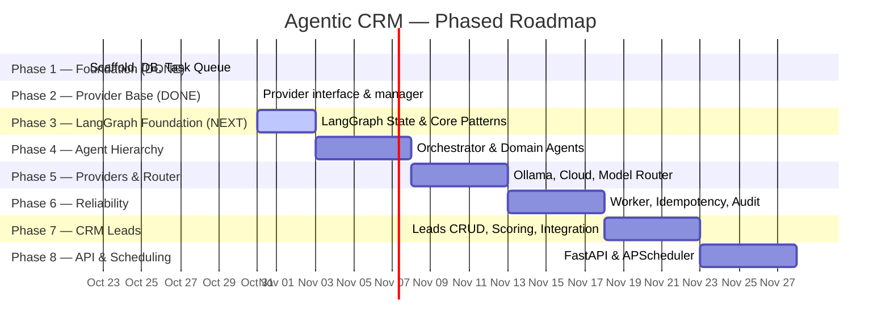

# Agentic CRM — Development Roadmap

> **Status:** Active — Phase 1 & Step 2.1 complete, LangGraph Foundation next  
> **Last updated:** 2026-10-31  
> **Approach:** Incremental, MVP-first. Each phase produces tested, working software.

---

## Milestone Status Summary

- **COMPLETED**:
  - **Phase 1 — Project Foundation**:
    - Milestone 1.1: Project Scaffold & Configuration ✅
    - Milestone 1.2: Database & Migrations ✅
    - Milestone 1.3: Task Model & Queue ✅
  - **Phase 2 — Provider Infrastructure**:
    - Milestone 2.1: Provider Interface & Manager ✅
- **CURRENT**:
  - Strategic realignment & preparation for LangGraph Foundation
- **NEXT**:
  - **Phase 3 — LangGraph Foundation**:
    - State -> Node -> Graph -> Edge -> Compile -> Invoke core execution patterns
    - Sequential execution, conditional routing, parallel execution, loops
    - Validated with deterministic & test providers via existing `ProviderManager`
- **FUTURE (Re-sequenced)**:
  - **Phase 4 — Agent Hierarchy**: Orchestrator, Domain Agents, CLI Intake (built on LangGraph)
  - **Phase 5 — Concrete Providers & Model Router**: Ollama, Gemini, Groq, Model Router (deferred; to be plugged into the LangGraph execution layer)
  - **Phase 6 — Reliability & Recovery**: Worker loop, crash recovery, idempotency, audit logging
  - **Phase 7 — First CRM Feature**: Leads CRUD, rule-based scoring, Sales Agent integration
  - **Phase 8 — API & Scheduling**: FastAPI REST layer, APScheduler

---

## Phase Overview

---

## Phase 1 — Project Foundation

**Goal:** Bootable project with config, database, and task persistence.

### Milestone 1.1 — Project Scaffold & Configuration
| Item | Detail |
|---|---|
| **Work** | Create `pyproject.toml`, directory structure per architecture doc, `.gitignore`, `.env.example`, `README.md`, `config.py` (loads env vars via `python-dotenv`) |
| **Acceptance** | `pip install -e .` succeeds; `python -m src.config` prints loaded config (with no real secrets); `.gitignore` excludes `.env`, `*.db`, `__pycache__/`, `.venv/` |
| **Tests** | `test_config.py` — config loads defaults when no `.env` present; missing required vars raise clear errors |
| **Dependencies** | None (first milestone) |

### Milestone 1.2 — Database & Migrations
| Item | Detail |
|---|---|
| **Work** | SQLite connection manager (`aiosqlite`), initial schema (tasks, task_queue, providers, audit_log), migration runner (numbered SQL scripts) |
| **Acceptance** | Running migrations creates all tables; schema can be inspected; re-running is idempotent |
| **Tests** | `test_database.py` — tables created correctly, migration idempotency, connection open/close |
| **Dependencies** | Milestone 1.1 |

### Milestone 1.3 — Task Model & Queue
| Item | Detail |
|---|---|
| **Work** | Task dataclass/Pydantic model, enqueue/dequeue functions, status transitions (PENDING → IN_PROGRESS → COMPLETED/FAILED/RETRY), priority support |
| **Acceptance** | Tasks can be created, enqueued, dequeued by priority, status-transitioned, and persisted across restarts |
| **Tests** | `test_task.py`, `test_queue.py` — CRUD, ordering, status transitions, persistence after simulated restart |
| **Dependencies** | Milestone 1.2 |

---

## Phase 2 — Provider Infrastructure

**Goal:** Establish provider abstraction, registry, health tracking, and circuit breakers.

### Milestone 2.1 — Provider Interface & Manager ✅
| Item | Detail |
|---|---|
| **Work** | `BaseProvider` ABC (common interface: `generate()`, `health_check()`, `get_quota()`), `ProviderManager` (registry, health tracking, circuit breaker, rate-limit backoff), `is_paid` flag enforcement |
| **Acceptance** | Providers can be registered, health-checked; paid providers are never auto-selected; circuit breaker triggers after N failures |
| **Tests** | `test_provider_base.py`, `test_provider_manager.py` — mock providers, paid-rejection, circuit breaker, fallback ordering (224 tests passing) |
| **Dependencies** | Milestone 1.3 |
| **Status** | **COMPLETED** (Commit `79b3866`) |

> **Strategic Realignment Note:** Milestones 2.2 (Ollama), 2.3 (Cloud Providers), and 2.4 (Model Router) are deferred to **Phase 5**. The existing `ProviderManager` and `BaseProvider` ABC provide sufficient mock/test support to build and validate the LangGraph orchestration layer without needing live LLM APIs.

---

## Phase 3 — LangGraph Foundation (NEXT)

**Goal:** Establish state-machine graph orchestration patterns using LangGraph before building domain agents.

### Milestone 3.1 — LangGraph Core & State Patterns
| Item | Detail |
|---|---|
| **Work** | Add `langgraph` dependency; define typed State schemas; build core execution pattern: `State -> Node -> Graph -> Edge -> Compile -> Invoke` |
| **Acceptance** | Basic graph compiles, accepts state input, executes sequential nodes deterministically, returns modified state |
| **Tests** | `tests/test_graph_core.py` — state schema validation, node execution, state transitions, compilation |
| **Dependencies** | Milestone 2.1 |
| **Status** | **NEXT MILESTONE** |

### Milestone 3.2 — Execution Topologies (Branching, Loops & Parallel)
| Item | Detail |
|---|---|
| **Work** | Implement conditional routing edges, iterative loops with termination conditions, and parallel node execution patterns in LangGraph |
| **Acceptance** | Graphs dynamically route based on state predicates; loops terminate safely; parallel branches aggregate state cleanly |
| **Tests** | `tests/test_graph_topologies.py` — conditional routing, cycle detection/termination, parallel fan-out/fan-in |
| **Dependencies** | Milestone 3.1 |

### Milestone 3.3 — Provider & Task Integration
| Item | Detail |
|---|---|
| **Work** | Integrate graph execution with existing `ProviderManager` (using mock/fake providers) and CRM `Task` data models |
| **Acceptance** | Graph nodes invoke provider abstractions via `ProviderManager`; task state maps to/from LangGraph state |
| **Tests** | `tests/test_graph_provider_integration.py` — graph invocation with fake provider, task lifecycle mapping |
| **Dependencies** | Milestone 3.2 |

---

## Phase 4 — Agent Hierarchy

**Goal:** Working orchestrator → domain agent → tool chain implemented via LangGraph.

### Milestone 4.1 — Grandparent Orchestrator
| Item | Detail |
|---|---|
| **Work** | Orchestrator graph: receives tasks from queue, classifies domain (rule-based initially), delegates to registered domain agent sub-graphs, tracks lifecycle, handles top-level errors |
| **Acceptance** | Orchestrator correctly routes a "sales" task to the Sales Agent sub-graph and an unknown task to an error handler |
| **Tests** | `test_orchestrator.py` — routing, unknown domain handling, lifecycle tracking |
| **Dependencies** | Phase 3 (LangGraph Foundation) |

### Milestone 4.2 — Sales Domain Agent (Stub)
| Item | Detail |
|---|---|
| **Work** | `SalesAgent` sub-graph: receives delegated tasks, decomposes into sub-tasks, calls tools or provider interfaces, aggregates results |
| **Acceptance** | Sales Agent receives a task, executes a simple tool (e.g., echo), returns structured result to orchestrator |
| **Tests** | `test_sales_agent.py` — task decomposition, tool execution, result aggregation |
| **Dependencies** | Milestone 4.1 |

### Milestone 4.3 — CLI Intake Layer
| Item | Detail |
|---|---|
| **Work** | Simple CLI (`argparse` or `click`) that accepts a task description, creates a Task, enqueues it, runs the orchestrator graph, and prints the result |
| **Acceptance** | `python -m src.main "Qualify lead John Doe"` → task created → routed → result printed |
| **Tests** | `test_cli.py` — CLI parsing, task creation, end-to-end smoke test with mock providers |
| **Dependencies** | Milestone 4.2 |

---

## Phase 5 — Concrete Providers & Task/Model Router

**Goal:** Multiple real LLM providers with failover, and a router that selects the cheapest suitable method.

### Milestone 5.1 — Local Provider (Ollama)
| Item | Detail |
|---|---|
| **Work** | `OllamaProvider` implementing `BaseProvider`, connects to local Ollama HTTP API, model selection, timeout handling |
| **Acceptance** | If Ollama is running locally with a model pulled, `generate()` returns a response. If Ollama is down, provider gracefully reports unhealthy. |
| **Tests** | `test_ollama_provider.py` — mocked HTTP responses for success, timeout, unavailable; optional live test with `--run-live` |
| **Dependencies** | Milestone 2.1 |

### Milestone 5.2 — Cloud Providers (Gemini, Groq)
| Item | Detail |
|---|---|
| **Work** | `GeminiProvider`, `GroqProvider` implementing `BaseProvider`, API key from env, quota tracking from response headers, rate-limit detection |
| **Acceptance** | Each provider works with a valid free-tier key; quota exhaustion is detected and handled; missing API key → provider disabled (not crashed) |
| **Tests** | Mocked tests for success, rate-limit (429), quota exhaustion, auth failure; optional live tests |
| **Dependencies** | Milestone 2.1 |

### Milestone 5.3 — Task/Model Router
| Item | Detail |
|---|---|
| **Work** | `ModelRouter` with capability levels (DETERMINISTIC, ML, LOCAL_SLM, CLOUD_LLM, CLOUD_LLM_CAPABLE), routing logic that queries `ProviderManager` for availability, fallback chain, strict no-paid policy |
| **Acceptance** | Router selects lowest-cost available method; falls back correctly when providers are down; never selects a paid provider; deterministic tasks bypass LLM entirely |
| **Tests** | `test_model_router.py` — routing decisions with various provider availability scenarios, capability matching, paid-provider rejection |
| **Dependencies** | Milestones 5.1–5.2 |

---

## Phase 6 — Reliability & Recovery

**Goal:** The system can survive crashes, retries, and provider outages without data loss or duplicate actions.

### Milestone 6.1 — Worker Loop & Recovery
| Item | Detail |
|---|---|
| **Work** | Async worker loop that polls the task queue, processes tasks via orchestrator, handles timeouts, requeues stale `IN_PROGRESS` tasks on startup |
| **Acceptance** | Worker processes queued tasks; simulated crash → restart → stale tasks are requeued and reprocessed |
| **Tests** | `test_worker.py` — processing, timeout, restart recovery |
| **Dependencies** | Milestone 4.3 |

### Milestone 6.2 — Idempotency & Deduplication
| Item | Detail |
|---|---|
| **Work** | Idempotency key generation per task, dedup check before side-effecting actions, idempotency record table |
| **Acceptance** | Replaying a task with the same idempotency key does not produce duplicate side effects |
| **Tests** | `test_idempotency.py` — duplicate detection, key generation, replay safety |
| **Dependencies** | Milestone 6.1 |

### Milestone 6.3 — Audit Logging
| Item | Detail |
|---|---|
| **Work** | Structured audit log (who/what/when/why) for all agent decisions, provider calls, and task state changes |
| **Acceptance** | Every task execution produces a traceable audit trail in the database |
| **Tests** | `test_audit.py` — log creation, queryability, completeness |
| **Dependencies** | Milestone 6.2 |

---

## Phase 7 — First CRM Feature: Leads

**Goal:** A real CRM capability — managing and scoring leads — wired through the full agent hierarchy.

### Milestone 7.1 — Leads Module (CRUD)
| Item | Detail |
|---|---|
| **Work** | `Lead` model (name, email, company, source, status, score, notes, timestamps), CRUD service, database table and migration |
| **Acceptance** | Leads can be created, read, updated, deleted, listed with filters |
| **Tests** | `test_leads_crud.py` — full CRUD, validation, filtering |
| **Dependencies** | Milestone 6.3 |

### Milestone 7.2 — Lead Scoring (Rules-Based)
| Item | Detail |
|---|---|
| **Work** | Rule-based lead scoring engine (configurable criteria: company size, source, engagement), score calculation, score persistence |
| **Acceptance** | New or updated leads get a score; scoring rules can be configured without code changes |
| **Tests** | `test_lead_scoring.py` — various lead profiles, edge cases, config changes |
| **Dependencies** | Milestone 7.1 |

### Milestone 7.3 — Sales Agent + Leads Integration
| Item | Detail |
|---|---|
| **Work** | Wire Sales Agent to use Leads tools (create, score, qualify), orchestrator routes lead-related tasks to Sales Agent, optional LLM-powered lead summary |
| **Acceptance** | `"Create lead: John Doe, ACME Corp"` → Lead created, scored, result returned via CLI |
| **Tests** | `test_sales_leads_integration.py` — end-to-end with mock providers |
| **Dependencies** | Milestones 7.1, 7.2, 4.2 |

---

## Phase 8 — API & Scheduling (Future)

**Goal:** External access and time-based automation.

### Milestone 8.1 — FastAPI REST Layer
| Item | Detail |
|---|---|
| **Work** | REST endpoints for tasks and leads, OpenAPI documentation, async handlers |
| **Acceptance** | CRUD operations via HTTP, Swagger UI accessible |
| **Tests** | `test_api.py` — endpoint tests with `httpx` |
| **Dependencies** | Phase 7 |

### Milestone 8.2 — Scheduled Tasks
| Item | Detail |
|---|---|
| **Work** | APScheduler integration, cron-style task definitions, scheduled lead re-scoring |
| **Acceptance** | A scheduled task runs at defined intervals; missed schedules are caught up on restart |
| **Tests** | `test_scheduler.py` — scheduling, execution, recovery |
| **Dependencies** | Milestone 8.1 |

---

## Future Phases (Not Yet Planned in Detail)

| Phase | Scope |
|---|---|
| **7** | Contacts & Accounts modules, relationship linking |
| **8** | Service Agent — ticket/case management |
| **9** | Marketing Agent — campaign management, email templates |
| **10** | RAG / Semantic search with vector DB |
| **11** | Web dashboard UI |
| **12** | Multi-user auth and RBAC |
| **13** | Deployment to always-on server for 24/7 operation |

---

## Risk Register

| # | Risk | Likelihood | Impact | Mitigation |
|---|---|---|---|---|
| R1 | Free API quotas reduced or eliminated without notice | High | High | Multiple providers, local fallback, graceful degradation, task queuing |
| R2 | Rate limiting causes task failures | High | Medium | Exponential backoff with jitter, circuit breaker, provider rotation |
| R3 | Duplicate actions after retry (e.g., duplicate emails) | Medium | High | Idempotency keys, dedup checks before side effects |
| R4 | Local SLM too slow or low-quality on CPU | Medium | Medium | Use smallest effective models; reserve LLM for tasks that truly need it; accept slower dev/test performance |
| R5 | SQLite concurrency limits under load | Low (dev) | Medium | Single-writer design; migrate to PostgreSQL when needed |
| R6 | Laptop not suitable for 24/7 operation | Certain | Medium | Document limitation; plan for server deployment in Phase 13; don't promise 24/7 until infra exists |
| R7 | Security — API keys leaked in code | Medium | High | `.env` + `.gitignore` + pre-commit hooks + code review discipline |
| R8 | Scope creep — trying to build all of Salesforce | Medium | High | Strict phase gating; each phase requires passing tests before the next begins |
| R9 | Provider API changes break adapters | Medium | Medium | Adapter pattern isolates changes; version-pin SDK dependencies |
| R10 | Data loss from SQLite file corruption | Low | High | Regular backups (manual initially); WAL mode for crash safety |

---

## Next Implementation Milestone: Phase 3 — LangGraph Foundation

**The next implementation step is Phase 3 — LangGraph Foundation (Milestones 3.1–3.3):**

1. **Milestone 3.1:** LangGraph Core & State Patterns (`State -> Node -> Graph -> Edge -> Compile -> Invoke`).
2. **Milestone 3.2:** Execution Topologies (Conditional routing, iterative loops, parallel branches).
3. **Milestone 3.3:** Provider & Task Integration (Wiring graph nodes with `ProviderManager` via test/mock providers and mapping to `Task` lifecycle).

**Why prioritize this next:**
- Establishes the graph state-machine orchestration engine before building high-level domain agents.
- Can be completely tested and verified with deterministic code and fake providers ($0 cost, 100% test reliability).
- Does not block on external LLM services (Ollama or cloud APIs).
- Concrete providers and Model Router can easily be plugged into graph nodes once the orchestration patterns are proven.

---

*This roadmap will be updated as phases are completed and new requirements emerge.*
