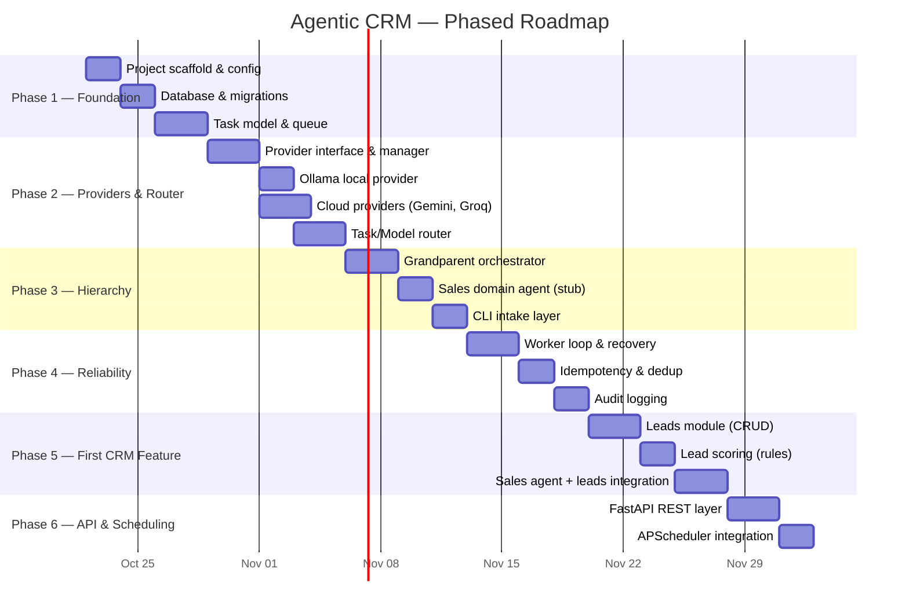

# Agentic CRM — Development Roadmap

> **Status:** Draft v0.1 · Planning phase  
> **Last updated:** 2026-10-22  
> **Approach:** Incremental, MVP-first. Each phase produces tested, working software.

---

## Phase Overview

---

## Phase 1 — Project Foundation

**Goal:** Bootable project with config, database, and task persistence.

### Milestone 1.1 — Project Scaffold & Configuration
| Item | Detail |
|---|---|
| **Work** | Create `pyproject.toml`, directory structure per architecture doc, `.gitignore`, `.env.example`, `README.md`, `config.py` (loads env vars via `python-dotenv`) |
| **Acceptance** | `pip install -e .` succeeds; `python -m src.config` prints loaded config (with no real secrets); `.gitignore` excludes `.env`, `*.db`, `__pycache__/`, `.venv/` |
| **Tests** | `test_config.py` — config loads defaults when no `.env` present; missing required vars raise clear errors |
| **Dependencies** | None (first milestone) |

### Milestone 1.2 — Database & Migrations
| Item | Detail |
|---|---|
| **Work** | SQLite connection manager (`aiosqlite`), initial schema (tasks, task_queue, providers, audit_log), migration runner (numbered SQL scripts) |
| **Acceptance** | Running migrations creates all tables; schema can be inspected; re-running is idempotent |
| **Tests** | `test_database.py` — tables created correctly, migration idempotency, connection open/close |
| **Dependencies** | Milestone 1.1 |

### Milestone 1.3 — Task Model & Queue
| Item | Detail |
|---|---|
| **Work** | Task dataclass/Pydantic model, enqueue/dequeue functions, status transitions (PENDING → IN_PROGRESS → COMPLETED/FAILED/RETRY), priority support |
| **Acceptance** | Tasks can be created, enqueued, dequeued by priority, status-transitioned, and persisted across restarts |
| **Tests** | `test_task.py`, `test_queue.py` — CRUD, ordering, status transitions, persistence after simulated restart |
| **Dependencies** | Milestone 1.2 |

---

## Phase 2 — Providers & Task/Model Router

**Goal:** Multiple LLM providers with failover, and a router that selects the cheapest suitable method.

### Milestone 2.1 — Provider Interface & Manager
| Item | Detail |
|---|---|
| **Work** | `BaseProvider` ABC (common interface: `generate()`, `health_check()`, `get_quota()`), `ProviderManager` (registry, health tracking, circuit breaker, rate-limit backoff), `is_paid` flag enforcement |
| **Acceptance** | Providers can be registered, health-checked; paid providers are never auto-selected; circuit breaker triggers after N failures |
| **Tests** | `test_provider_base.py`, `test_provider_manager.py` — mock providers, paid-rejection, circuit breaker, fallback ordering |
| **Dependencies** | Milestone 1.3 |

### Milestone 2.2 — Local Provider (Ollama)
| Item | Detail |
|---|---|
| **Work** | `OllamaProvider` implementing `BaseProvider`, connects to local Ollama HTTP API, model selection, timeout handling |
| **Acceptance** | If Ollama is running locally with a model pulled, `generate()` returns a response. If Ollama is down, provider gracefully reports unhealthy. |
| **Tests** | `test_ollama_provider.py` — mocked HTTP responses for success, timeout, unavailable; optional live test with `--run-live` |
| **Dependencies** | Milestone 2.1 |

### Milestone 2.3 — Cloud Providers (Gemini, Groq)
| Item | Detail |
|---|---|
| **Work** | `GeminiProvider`, `GroqProvider` implementing `BaseProvider`, API key from env, quota tracking from response headers, rate-limit detection |
| **Acceptance** | Each provider works with a valid free-tier key; quota exhaustion is detected and handled; missing API key → provider disabled (not crashed) |
| **Tests** | Mocked tests for success, rate-limit (429), quota exhaustion, auth failure; optional live tests |
| **Dependencies** | Milestone 2.1 |

### Milestone 2.4 — Task/Model Router
| Item | Detail |
|---|---|
| **Work** | `ModelRouter` with capability levels (DETERMINISTIC, ML, LOCAL_SLM, CLOUD_LLM, CLOUD_LLM_CAPABLE), routing logic that queries `ProviderManager` for availability, fallback chain, strict no-paid policy |
| **Acceptance** | Router selects lowest-cost available method; falls back correctly when providers are down; never selects a paid provider; deterministic tasks bypass LLM entirely |
| **Tests** | `test_model_router.py` — routing decisions with various provider availability scenarios, capability matching, paid-provider rejection |
| **Dependencies** | Milestones 2.1–2.3 |

---

## Phase 3 — Agent Hierarchy

**Goal:** Working orchestrator → domain agent → tool chain.

### Milestone 3.1 — Grandparent Orchestrator
| Item | Detail |
|---|---|
| **Work** | `Orchestrator` class: receives tasks from queue, classifies domain (rule-based initially), delegates to registered domain agents, tracks lifecycle, handles top-level errors |
| **Acceptance** | Orchestrator correctly routes a "sales" task to the Sales Agent stub and an unknown task to an error handler |
| **Tests** | `test_orchestrator.py` — routing, unknown domain handling, lifecycle tracking |
| **Dependencies** | Milestone 2.4 |

### Milestone 3.2 — Sales Domain Agent (Stub)
| Item | Detail |
|---|---|
| **Work** | `SalesAgent` class: receives delegated tasks, decomposes into sub-tasks (hardcoded initially), calls tools or router, aggregates results |
| **Acceptance** | Sales Agent receives a task, executes a simple tool (e.g., echo), returns structured result to orchestrator |
| **Tests** | `test_sales_agent.py` — task decomposition, tool execution, result aggregation |
| **Dependencies** | Milestone 3.1 |

### Milestone 3.3 — CLI Intake Layer
| Item | Detail |
|---|---|
| **Work** | Simple CLI (`argparse` or `click`) that accepts a task description, creates a Task, enqueues it, runs the orchestrator, and prints the result |
| **Acceptance** | `python -m src.main "Qualify lead John Doe"` → task created → routed → result printed |
| **Tests** | `test_cli.py` — CLI parsing, task creation, end-to-end smoke test with mock providers |
| **Dependencies** | Milestone 3.2 |

---

## Phase 4 — Reliability & Recovery

**Goal:** The system can survive crashes, retries, and provider outages without data loss or duplicate actions.

### Milestone 4.1 — Worker Loop & Recovery
| Item | Detail |
|---|---|
| **Work** | Async worker loop that polls the task queue, processes tasks via orchestrator, handles timeouts, requeues stale `IN_PROGRESS` tasks on startup |
| **Acceptance** | Worker processes queued tasks; simulated crash → restart → stale tasks are requeued and reprocessed |
| **Tests** | `test_worker.py` — processing, timeout, restart recovery |
| **Dependencies** | Milestone 3.3 |

### Milestone 4.2 — Idempotency & Deduplication
| Item | Detail |
|---|---|
| **Work** | Idempotency key generation per task, dedup check before side-effecting actions, idempotency record table |
| **Acceptance** | Replaying a task with the same idempotency key does not produce duplicate side effects |
| **Tests** | `test_idempotency.py` — duplicate detection, key generation, replay safety |
| **Dependencies** | Milestone 4.1 |

### Milestone 4.3 — Audit Logging
| Item | Detail |
|---|---|
| **Work** | Structured audit log (who/what/when/why) for all agent decisions, provider calls, and task state changes |
| **Acceptance** | Every task execution produces a traceable audit trail in the database |
| **Tests** | `test_audit.py` — log creation, queryability, completeness |
| **Dependencies** | Milestone 4.2 |

---

## Phase 5 — First CRM Feature: Leads

**Goal:** A real CRM capability — managing and scoring leads — wired through the full agent hierarchy.

### Milestone 5.1 — Leads Module (CRUD)
| Item | Detail |
|---|---|
| **Work** | `Lead` model (name, email, company, source, status, score, notes, timestamps), CRUD service, database table and migration |
| **Acceptance** | Leads can be created, read, updated, deleted, listed with filters |
| **Tests** | `test_leads_crud.py` — full CRUD, validation, filtering |
| **Dependencies** | Milestone 4.3 |

### Milestone 5.2 — Lead Scoring (Rules-Based)
| Item | Detail |
|---|---|
| **Work** | Rule-based lead scoring engine (configurable criteria: company size, source, engagement), score calculation, score persistence |
| **Acceptance** | New or updated leads get a score; scoring rules can be configured without code changes |
| **Tests** | `test_lead_scoring.py` — various lead profiles, edge cases, config changes |
| **Dependencies** | Milestone 5.1 |

### Milestone 5.3 — Sales Agent + Leads Integration
| Item | Detail |
|---|---|
| **Work** | Wire Sales Agent to use Leads tools (create, score, qualify), orchestrator routes lead-related tasks to Sales Agent, optional LLM-powered lead summary |
| **Acceptance** | `"Create lead: John Doe, ACME Corp"` → Lead created, scored, result returned via CLI |
| **Tests** | `test_sales_leads_integration.py` — end-to-end with mock providers |
| **Dependencies** | Milestones 5.1, 5.2, 3.2 |

---

## Phase 6 — API & Scheduling (Future)

**Goal:** External access and time-based automation.

### Milestone 6.1 — FastAPI REST Layer
| Item | Detail |
|---|---|
| **Work** | REST endpoints for tasks and leads, OpenAPI documentation, async handlers |
| **Acceptance** | CRUD operations via HTTP, Swagger UI accessible |
| **Tests** | `test_api.py` — endpoint tests with `httpx` |
| **Dependencies** | Phase 5 |

### Milestone 6.2 — Scheduled Tasks
| Item | Detail |
|---|---|
| **Work** | APScheduler integration, cron-style task definitions, scheduled lead re-scoring |
| **Acceptance** | A scheduled task runs at defined intervals; missed schedules are caught up on restart |
| **Tests** | `test_scheduler.py` — scheduling, execution, recovery |
| **Dependencies** | Milestone 6.1 |

---

## Future Phases (Not Yet Planned in Detail)

| Phase | Scope |
|---|---|
| **7** | Contacts & Accounts modules, relationship linking |
| **8** | Service Agent — ticket/case management |
| **9** | Marketing Agent — campaign management, email templates |
| **10** | RAG / Semantic search with vector DB |
| **11** | Web dashboard UI |
| **12** | Multi-user auth and RBAC |
| **13** | Deployment to always-on server for 24/7 operation |

---

## Risk Register

| # | Risk | Likelihood | Impact | Mitigation |
|---|---|---|---|---|
| R1 | Free API quotas reduced or eliminated without notice | High | High | Multiple providers, local fallback, graceful degradation, task queuing |
| R2 | Rate limiting causes task failures | High | Medium | Exponential backoff with jitter, circuit breaker, provider rotation |
| R3 | Duplicate actions after retry (e.g., duplicate emails) | Medium | High | Idempotency keys, dedup checks before side effects |
| R4 | Local SLM too slow or low-quality on CPU | Medium | Medium | Use smallest effective models; reserve LLM for tasks that truly need it; accept slower dev/test performance |
| R5 | SQLite concurrency limits under load | Low (dev) | Medium | Single-writer design; migrate to PostgreSQL when needed |
| R6 | Laptop not suitable for 24/7 operation | Certain | Medium | Document limitation; plan for server deployment in Phase 13; don't promise 24/7 until infra exists |
| R7 | Security — API keys leaked in code | Medium | High | `.env` + `.gitignore` + pre-commit hooks + code review discipline |
| R8 | Scope creep — trying to build all of Salesforce | Medium | High | Strict phase gating; each phase requires passing tests before the next begins |
| R9 | Provider API changes break adapters | Medium | Medium | Adapter pattern isolates changes; version-pin SDK dependencies |
| R10 | Data loss from SQLite file corruption | Low | High | Regular backups (manual initially); WAL mode for crash safety |

---

## Step 2 Recommendation

**The next implementation step should be Phase 1 — Project Foundation (Milestones 1.1–1.3):**

1. **Milestone 1.1:** Create the project scaffold — `pyproject.toml`, directory structure, `.gitignore`, `.env.example`, `README.md`, `config.py`.
2. **Milestone 1.2:** Set up SQLite database with connection manager and initial migration.
3. **Milestone 1.3:** Implement the Task model and SQLite-backed task queue.

**Why start here:**
- These are pure infrastructure with no external dependencies or API keys.
- They provide the foundation every later component builds on.
- They are fully testable locally without any cloud services.
- They establish the project structure, testing patterns, and development workflow.

**Prerequisite from you:**
- Confirm the architecture decisions in Section 11 of `architecture.md` (Python version, SQLAlchemy vs raw SQL, async, Ollama, Leads-first, license).
- Provide your GitHub repository URL when ready (no rush — code can be prepared locally first).

---

*This roadmap will be updated as phases are completed and new requirements emerge.*
